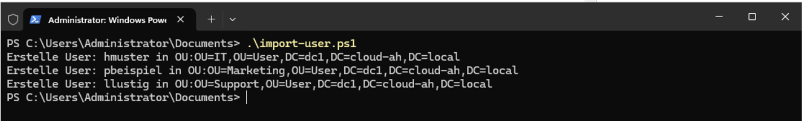

# Abgabe-Dokumentation: Identity Management und PowerShell-Debugging

## 1. Ausgangslage

Das PowerShell-Skript legt drei Benutzer aus einer CSV-Datei automatisiert im Windows
Active Directory an. Die Benutzer werden anhand ihrer Abteilung in die OUs `IT`,
`Marketing` und `Support` unterhalb von `OU=User` eingeordnet.

Verwendete AD-Domäne: `dc1.cloud-ah.local`

Verwendete OU-Struktur:

```text
OU=User,DC=dc1,DC=cloud-ah,DC=local
+-- OU=IT
+-- OU=Marketing
+-- OU=Support
```

Die CSV-Datei liegt unter `C:\Temp\mitarbeiter.csv` und verwendet Kommas als Trennzeichen:

```csv
Vorname,Nachname,Abteilung
Hans,Muster,IT
Petra,Beispiel,Marketing
Lars,Lustig,Support
```

## 2. Fehlerprotokoll

| Nr. | Problem | Lösung |
| --- | --- | --- |
| 1 | Das ursprüngliche Skript verwendete als CSV-Trennzeichen `;`, die Datei ist jedoch kommagetrennt. | `Import-Csv` verwendet nun `-Delimiter ","`. Dadurch werden `Vorname`, `Nachname` und `Abteilung` korrekt eingelesen. |
| 2 | Die ursprüngliche Domäne `it-tbz.local` passte nicht zur vorhandenen AD-Umgebung. | Der UPN verwendet `dc1.cloud-ah.local`, und der Distinguished Name verwendet `DC=dc1,DC=cloud-ah,DC=local`. |
| 3 | Für das Passwort wurde ursprünglich `ConvertFrom-SecureString` verwendet. Dieser Befehl erzeugt eine verschlüsselte Zeichenkette und ist für `-AccountPassword` ungeeignet. | Das Passwort wird mit `ConvertTo-SecureString -AsPlainText -Force` in einen SecureString umgewandelt. |
| 4 | Der ursprüngliche Wert für `-AccountPassword` war dadurch kein gültiges Passwortobjekt. | Der erzeugte SecureString wird in `$SecurePassword` gespeichert und an `New-ADUser` übergeben. |
| 5 | Vorname, Nachname und Abteilung wurden direkt aus der CSV-Zeile verwendet, was die weitere Verarbeitung unübersichtlich machte. | Die Werte werden zuerst in die Variablen `$vorname`, `$nachname` und `$abteilung` übernommen. |
| 6 | Der `sAMAccountName` musste dem vorgegebenen Format entsprechen. | Der erste Buchstabe des Vornamens wird mit dem Nachnamen kombiniert und mit `.ToLower()` kleingeschrieben. |
| 7 | Das Benutzerkonto musste in der Abteilungs-OU angelegt werden. | Der Zielpfad wird dynamisch als `OU=$abteilung,OU=User,DC=dc1,DC=cloud-ah,DC=local` gebildet. |
| 8 | Das Konto musste nach dem Erstellen aktiviert werden. | Nach `New-ADUser` wird `Enable-ADAccount -Identity $sAMAccountName` ausgeführt. |

## 3. Funktionierendes Skript

Der verwendete PowerShell-Code befindet sich in [import-users.ps1](import-users.ps1).
Das Skript wurde auf einem Domain Controller beziehungsweise auf einem Rechner mit
installiertem Active-Directory-Modul und ausreichenden Berechtigungen ausgeführt:

```powershell
.\import-users.ps1
```

Beim ersten erfolgreichen Lauf werden diese Konten erzeugt:

| Benutzer | sAMAccountName | Ziel-OU |
| --- | --- | --- |
| Hans Muster | `hmuster` | `OU=IT,OU=User,...` |
| Petra Beispiel | `pbeispiel` | `OU=Marketing,OU=User,...` |
| Lars Lustig | `llustig` | `OU=Support,OU=User,...` |

Das Skript enthält keine Prüfung auf bereits vorhandene Konten. Bei einem erneuten Lauf
muss deshalb kontrolliert werden, ob die Benutzer bereits existieren, da `New-ADUser` sonst
einen Fehler melden kann.

## 4. Erfolgsnachweis

Der vorhandene Screenshot zeigt den erfolgreichen Skriptlauf mit den drei Ziel-OUs:



Der Screenshot zeigt die Ausgaben für `hmuster`, `pbeispiel` und `llustig` sowie die korrekten
Zielpfade. Dieser Screenshot ist ein Laufnachweis, erfüllt aber noch nicht vollständig das
formale Abgabekriterium. Zusätzlich muss ein Screenshot aus **Active Directory Users and
Computers (`dsa.msc`)** erstellt werden. Darauf müssen die drei Benutzer in den OUs `IT`,
`Marketing` und `Support` sichtbar sein.

## 5. Prüfung

Die fachliche Prüfung erfolgt direkt in `dsa.msc`:

1. `dsa.msc` als Administrator öffnen.
2. Die Domäne `dc1.cloud-ah.local` öffnen.
3. `User` und danach nacheinander `IT`, `Marketing` und `Support` öffnen.
4. Kontrollieren, dass in jeder OU genau der erwartete Benutzer vorhanden ist.
5. Einen Screenshot erstellen, auf dem die drei OUs und die darin enthaltenen Benutzer nachvollziehbar sichtbar sind.

Hinweis: Eine PowerShell-Syntaxprüfung konnte auf dem Dokumentationssystem nicht ausgeführt
werden, weil `pwsh` dort nicht installiert ist. Die Ausführung des Skripts und die Kontrolle
der Benutzer müssen deshalb auf dem Windows-Domain-Controller mit installiertem
Active-Directory-Modul erfolgen.
