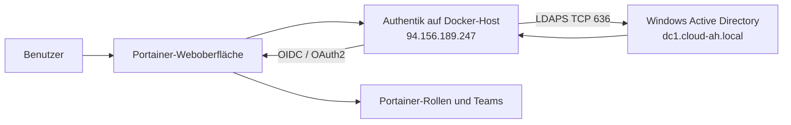

# Authentik SSO für Portainer mit Windows-AD über LDAPS

## 1. Übersicht

In dieser Umgebung übernimmt **Authentik** die Rolle des zentralen Identity Providers.
Die Benutzer und Gruppen werden aus dem Windows Active Directory gelesen. Authentik
verbindet sich dafür verschlüsselt über **LDAPS** mit dem Windows-Domain-Controller.

**Portainer** ist als Webanwendung an Authentik angebunden. Benutzer melden sich somit
nicht mit einem separaten Portainer-Konto an, sondern werden über den zentralen Authentik-
Login authentifiziert. Welche Benutzer sich anmelden dürfen und welche Rechte sie in
Portainer erhalten, wird über die konfigurierte Benutzer- oder Gruppenzuordnung gesteuert.



### Aktuelle Umgebung

| Komponente | Wert / Funktion |
| :--- | :--- |
| Identity Provider | Authentik |
| Authentik-Bereitstellung | Docker-Container ausserhalb von AWS |
| Öffentliche Authentik-IP | `94.156.189.247` |
| Authentik-Domain | `https://auth.cloud-ah.com` |
| Verzeichnisdienst | Windows Active Directory |
| Windows-AD-Domäne | `dc1.cloud-ah.local` |
| Windows-AD-Basis-DN | `DC=dc1,DC=cloud-ah,DC=local` |
| Verzeichnisprotokoll | LDAPS, TCP `636` |
| Zielanwendung | Portainer |
| Anwendungsauthentifizierung | OIDC / OAuth2 über Authentik |

Passwörter, Client-Secrets, private Schlüssel und Bind-Credentials werden nicht in dieser
Dokumentation oder im Git-Repository gespeichert.

#### Architekture


## 2. Funktionsweise

Der Login besteht aus mehreren getrennten Schritten:

1. Der Benutzer öffnet Portainer.
2. Portainer leitet den Benutzer zur Authentik-Anmeldeseite weiter.
3. Authentik sucht den Benutzer über die konfigurierte LDAP-Quelle im Windows AD.
4. Die Verbindung zwischen Authentik und dem Domain-Controller erfolgt verschlüsselt über LDAPS.
5. Nach erfolgreicher Anmeldung stellt Authentik ein OIDC-Token für Portainer aus.
6. Portainer prüft das Token und ordnet den Benutzer einer Rolle oder einem Team zu.

LDAP dient in dieser Architektur zur Benutzer- und Gruppenabfrage durch Authentik.
Portainer spricht für den Web-Login direkt mit Authentik über OIDC und nicht selbst mit
dem Domain-Controller.

## 3. Voraussetzungen

- Authentik läuft auf dem Docker-Host `94.156.189.247`.
- Authentik ist über eine gültige HTTPS-Domain erreichbar.
- Der Windows-Domain-Controller ist aus dem Authentik-Netz über TCP-Port `636` erreichbar.
- Ein gültiges LDAPS-Zertifikat ist auf dem Windows LDAP-Server installiert.
- Authentik kann die Zertifikatskette des Domain-Controllers validieren.
- Eine LDAP-Bind-Identität mit den minimal notwendigen Leserechten ist vorhanden.
- Portainer ist über HTTPS erreichbar.
- Ein OIDC-Provider und eine OIDC-Anwendung für Portainer werden in Authentik angelegt.
- Für berechtigte Benutzer oder Gruppen ist eine Portainer-Rolle definiert.

## 4. Netzwerk und Firewall

Der Windows-Domain-Controller muss eingehende LDAPS-Verbindungen vom Authentik-Host
zulassen. Die Regel sollte möglichst auf die einzelne öffentliche IP beschränkt sein:

| Quelle | Ziel | Protokoll / Port | Zweck |
| :--- | :--- | :--- | :--- |
| `94.156.189.247/32` | Windows AD / Domain Controller | TCP `636` | Authentik zu Windows AD über LDAPS |

Der LDAP-Port `389` sollte für diese Verbindung nicht verwendet werden, weil LDAP ohne
TLS die Anmelde- und Verzeichnisdaten nicht ausreichend schützt. Für den Produktivbetrieb
sollte der Authentik-Host nach Möglichkeit über VPN oder eine private Netzwerkverbindung
mit AWS verbunden werden. Eine öffentliche LDAPS-Freigabe bleibt ein exponierter Dienst
und muss überwacht sowie auf die notwendige Quell-IP beschränkt werden.

## 5. LDAPS-Verbindung zum Windows AD

### 5.1 LDAP-Quelle in Authentik anlegen

In Authentik wird unter **Directory -> Federation and Social login -> LDAP Sources** eine
neue LDAP-Quelle angelegt. Die Bezeichnungen können je nach Authentik-Version leicht
abweichen.

Empfohlene Werte für die Windows-AD-Quelle:

| Feld | Wert |
| :--- | :--- |
| Name | Zum Beispiel `Windows-AD-LDAPS` |
| Server URI | `ldaps://44.214.32.188:636` |
| Base DN | `DC=dc1,DC=cloud-ah,DC=local` |
| Bind DN | Dienstkonto mit Leserechten im AD |
| Bind password | Sicheres Secret, nicht in Git dokumentieren |
| StartTLS | Deaktiviert, wenn bereits `ldaps://` verwendet wird |
| TLS certificate validation | Aktiviert |

Die genaue Bind-DN hängt vom angelegten Dienstkonto ab. Sie darf nur die erforderlichen
Verzeichnisdaten lesen. Ein Domain-Administrator ist für die LDAP-Abfrage nicht notwendig.

### 5.2 Benutzer- und Gruppenfilter

Die Quelle sollte auf die benötigte OU oder Gruppe eingeschränkt werden, sofern das
Szenario keine vollständige Verzeichnissynchronisation verlangt. Dadurch werden weniger
Konten importiert und die Berechtigungszuordnung bleibt übersichtlich.

Werte, die an die tatsächliche AD-Struktur angepasst werden müssen:

```text
User search base:   OU=Users,DC=dc1,DC=cloud-ah,DC=local
Group search base:  OU=Groups,DC=dc1,DC=cloud-ah,DC=local
User attribute:     sAMAccountName
Mail attribute:     mail
Display name:       displayName
Group membership:   memberOf
```

Die tatsächlichen OUs und Attribute müssen in Active Directory geprüft werden. Falsche
Suchbasen führen dazu, dass Authentik die Benutzer zwar über LDAPS erreicht, aber keine
Konten findet.

### 5.3 LDAPS testen

Die Erreichbarkeit sollte zuerst vom Authentik-Docker-Host getestet werden. Ein TLS-Test
zeigt, ob der Port offen ist und welches Zertifikat der Domain-Controller präsentiert:

```bash
openssl s_client -connect dc1.cloud-ah.local:636 \\
	-servername dc1.cloud-ah.local \\
	-showcerts
```

Die Ausgabe muss ohne Zertifikatsfehler enden. Zusätzlich kann mit einem LDAP-Testwerkzeug
eine Suche mit dem vorgesehenen Bind-Konto durchgeführt werden:

```bash
ldapsearch -H ldaps://dc1.cloud-ah.local:636 \\
	-D 'BIND-DN-HIER-EINSETZEN' -W \\
	-b 'DC=dc1,DC=cloud-ah,DC=local' \\
	'(sAMAccountName=TESTBENUTZER)'
```

Das Bind-Passwort wird interaktiv eingegeben und darf nicht in der Shell-History oder in
dieser Dokumentation gespeichert werden.

## 6. Authentik als OIDC-Provider für Portainer

### 6.1 Provider erstellen

In Authentik wird unter **Applications -> Providers** ein neuer **OAuth2/OpenID Provider**
für Portainer erstellt.

Typische Einstellungen:

| Einstellung | Wert |
| :--- | :--- |
| Name | Zum Beispiel `Portainer-OIDC` |
| Client type | `Confidential` |
| Redirect URI | Die von Portainer geforderte OIDC-Callback-URL |
| Signing key | Ein gültiger Authentik-Signaturschlüssel |
| Scopes | `openid`, `profile`, `email`, optional `groups` |
| Subject mode | Stabiler Benutzer-Identifier, sofern verfügbar |

Die Redirect URI muss exakt mit der Portainer-Konfiguration übereinstimmen. Schon ein
abweichender Pfad, ein anderes Schema (`http` statt `https`) oder ein zusätzlicher Slash
kann den Callback ablehnen.

### 6.2 Authentik-Anwendung zuordnen

Nach dem Provider wird eine Authentik-Anwendung angelegt und mit dem Provider verbunden.
Die Anwendung ist der sichtbare Login-Eintrag für Portainer. Für die Dokumentation werden
folgende Werte festgehalten:

| Feld | Wert |
| :--- | :--- |
| Application name | `Portainer` |
| Slug | Zum Beispiel `portainer` |
| Provider | `Portainer-OIDC` |
| Launch URL | Öffentliche HTTPS-URL von Portainer |

## 7. Portainer konfigurieren

In Portainer wird unter den Authentifizierungs- oder Security-Einstellungen die OIDC-
Anmeldung aktiviert. Die genaue Menübezeichnung hängt von der Portainer-Version und der
eingesetzten Edition ab.

Die Konfiguration verwendet die Werte aus Authentik:

| Portainer-Feld | Inhalt |
| :--- | :--- |
| Provider / Issuer URL | Authentik-Issuer der `Portainer-OIDC`-Anwendung |
| Client ID | Von Authentik erzeugte Client-ID |
| Client secret | Von Authentik erzeugtes Secret |
| Scopes | `openid profile email` und gegebenenfalls `groups` |
| User claim | Üblicherweise `preferred_username` oder `email` |
| Group claim | `groups`, falls Gruppen im Token ausgegeben werden |

Die Werte werden aus Sicherheitsgründen nicht in Git gespeichert. Vor dem Speichern sollte
ein lokales Portainer-Administratorkonto erhalten bleiben, damit ein fehlerhaftes OIDC-
Setup nicht den Zugang zur Administration blockiert.

## 8. Berechtigte Benutzer und Portainer-Rollen

Die Authentifizierung allein gewährt noch keine gewünschte Portainer-Berechtigung. Nach
dem erfolgreichen Login muss Portainer den Benutzer einer Rolle, einem Team oder einer
Umgebung zuordnen.

Empfohlener Ablauf:

1. Eine dedizierte AD-Gruppe für Portainer-Benutzer anlegen, zum Beispiel `Portainer-Users`.
2. Die Gruppe in der Authentik-LDAP-Quelle synchronisieren.
3. Den Gruppen-Claim im OIDC-Token aktivieren, falls die Portainer-Version dies benötigt.
4. Die Gruppe in Portainer einer passenden Rolle oder einem Team zuordnen.
5. Nur Administratoren einer ausdrücklich dafür vorgesehenen Gruppe zuweisen.
6. Den Zugriff mit einem Benutzer testen, der Mitglied und mit einem Benutzer, der nicht Mitglied ist.

Das genaue Mapping hängt von der verwendeten Portainer-Version und Edition ab. Die
Gruppennamen und Rollen sollten als Screenshot dokumentiert werden.

## 9. Funktionstest

### Positiver Test

1. Einen Testbenutzer in der Windows-AD-Berechtigungsgruppe anlegen.
2. Prüfen, dass Authentik den Benutzer über die LDAP-Quelle synchronisiert.
3. Die Portainer-Anmeldeseite öffnen.
4. **Login with Authentik** auswählen.
5. Mit dem Windows-AD-Konto anmelden.
6. Prüfen, dass Authentik den Benutzer erfolgreich authentifiziert.
7. Prüfen, dass Portainer die korrekte Rolle und Umgebung anzeigt.

### Negativer Test

1. Einen AD-Benutzer verwenden, der nicht Mitglied der Portainer-Gruppe ist.
2. Anmeldung über Authentik durchführen.
3. Prüfen, dass der Benutzer keinen unberechtigten Portainer-Zugriff erhält.
4. Die Authentik- und Portainer-Protokolle auf eine nachvollziehbare Ablehnung prüfen.

### Technische Prüfungen

```bash
# Erreichbarkeit von LDAPS
nc -vz dc1.cloud-ah.local 636

# Zertifikats- und TLS-Prüfung
openssl s_client -connect dc1.cloud-ah.local:636 \\
	-servername dc1.cloud-ah.local
```

## 10. Fehleranalyse

| Problem | Wahrscheinliche Ursache | Prüfung |
| :--- | :--- | :--- |
| Authentik erreicht AD nicht | Firewall oder Routing blockiert TCP 636 | `nc -vz` vom Docker-Host, AWS-Sicherheitsgruppe prüfen |
| TLS-Zertifikat wird abgelehnt | Falscher Hostname, abgelaufenes Zertifikat oder fehlende CA | `openssl s_client` und Zertifikatskette prüfen |
| Keine Benutzer gefunden | Base DN, OU oder LDAP-Filter falsch | LDAP-Suche manuell mit `ldapsearch` durchführen |
| LDAP-Bind schlägt fehl | Falsche Bind-DN oder falsches Secret | Dienstkonto und Passwort sicher prüfen |
| OIDC-Callback schlägt fehl | Redirect URI stimmt nicht exakt überein | Authentik-Provider und Portainer vergleichen |
| Login erfolgreich, aber kein Portainer-Zugriff | Rollen- oder Gruppenmapping fehlt | Token-Claims und Portainer-Teamzuordnung prüfen |
| Benutzer sieht falsche Rolle | Gruppenclaim oder Mapping ist zu weit gefasst | Authentik-Flow, Gruppen und Portainer-Rollen prüfen |

## 11. Sicherheits- und Betriebsanforderungen

- LDAPS ausschliesslich mit gültiger Zertifikatsprüfung verwenden.
- TCP-Port `636` nur für `94.156.189.247/32` freigeben, sofern diese Architektur beibehalten wird.
- Einen dedizierten LDAP-Lesebenutzer mit minimalen Rechten verwenden.
- Authentik, Portainer, Docker-Images und das Betriebssystem regelmässig aktualisieren.
- OIDC-Client-Secret und LDAP-Bind-Passwort in einem Secret-Store oder Docker Secret verwalten.
- Keine Secrets, Tokens oder privaten Zertifikate in Screenshots oder Git committen.
- Für Authentik und Portainer MFA aktivieren, sofern die eingesetzte Konfiguration dies unterstützt.
- Authentik-, Portainer- und Docker-Logs regelmässig auf fehlgeschlagene Anmeldungen prüfen.
- Ein lokales Notfall-Administratorkonto für Portainer sicher verwahren.
- Backups und Wiederherstellung für Authentik-Datenbank, Konfiguration und Portainer einrichten.

## 12. Nachweis und Screenshots

| Nachweis | Sichtbarer Inhalt | Empfohlener Dateiname |
| :--- | :--- | :--- |
| Authentik-Übersicht | Authentik-Anwendung `Portainer` |  |
| LDAP-Quelle | Windows-AD-LDAPS-Quelle, Hostname, Port 636 und Base DN |  |
| OIDC-Provider | Portainer-Provider ohne sichtbares Client-Secret |  |
| Portainer-Konfiguration | Aktivierte OIDC-Anmeldung ohne Secret |  ||

## 13. Ergebnis

Authentik läuft ausserhalb von AWS in einem Docker-Container unter `94.156.189.247`.
Die Benutzer werden über eine verschlüsselte LDAPS-Verbindung aus dem Windows Active
Directory gelesen. Portainer verwendet Authentik als OIDC-Identity-Provider. Dadurch
können berechtigte Windows-AD-Benutzer zentral verwaltet und für den Login in Portainer
freigeschaltet werden, ohne separate Portainer-Passwörter für jeden Benutzer zu pflegen.
