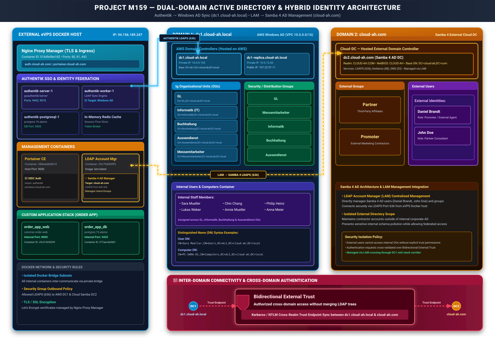
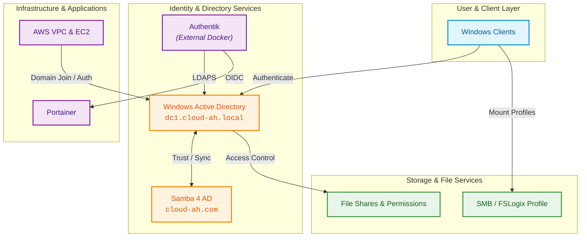

# Modul 159 | Active Directory, Cloud und SSO

## Projektdokumentation

Dieses Repository dokumentiert den Aufbau einer hybriden Windows- und Cloud-Umgebung im
Rahmen von Modul 159. Die Dokumentation verbindet klassische Active-Directory-
Administration mit AWS-Infrastruktur, Dateidiensten, Identitätsmanagement und Single
Sign-on.

### Projekt auf einen Blick

| Bereich | Inhalt |
| :--- | :--- |
| Lokale Identität | Windows Active Directory und Samba 4 AD |
| Infrastruktur | AWS VPC, EC2, Sicherheitsgruppen und Domain Controller |
| Administration | RSAT, Windows Admin Center, GPOs und PowerShell |
| Dateidienste | SMB-Freigaben, NTFS-Berechtigungen, Netzlaufwerke und FSLogix |
| Cloud- und Web-Integration | AWS, Docker, Authentik, LDAPS, OIDC und Portainer |
| Web und SSO | Authentik, LDAPS, OIDC und Portainer |
| Nachweis | Konfigurationsschritte, Tests, Screenshots und Fehleranalyse |

### Eingesetzte Technologien

| Technologie | Verwendung im Projekt |
| :--- | :--- |
| **Windows Server / AD DS** | Primärer Domain Controller, DNS, Benutzer, Gruppen und Kerberos |
| **Samba 4 AD** | Separater Active-Directory-kompatibler Domain Controller und zweite Domäne |
| **AWS** | VPC, Subnetze, EC2-Instanzen und Security Groups für die Infrastruktur |
| **PowerShell** | Automatisierter Benutzerimport, Tests und Administration |
| **Group Policy (GPO)** | Konfiguration von Clients, Sicherheit, Laufwerken und FSLogix |
| **RSAT / Windows Admin Center** | Zentrale Verwaltung von Windows Server und Active Directory |
| **SMB und NTFS** | Dateifreigaben, Netzlaufwerke, Zugriffsrechte und Access-Based Enumeration |
| **FSLogix** | Servergespeicherte Benutzerprofile über VHD/VHDX-Container |
| **Docker** | Betrieb von Authentik als containerisierte Webanwendung ausserhalb von AWS |
| **Authentik** | Identity Provider für zentrale Web-Authentifizierung und SSO |
| **LDAP / LDAPS** | Verschlüsselte Benutzer- und Gruppenabfrage aus dem Windows AD |
| **OIDC / OAuth2** | Standardisierte Anmeldung von Portainer über Authentik |
| **Portainer** | Webanwendung für Docker-Verwaltung mit autorisiertem SSO-Zugriff |

## Architektur

Die Aufträge sind in zwei Blöcke gegliedert:

- **Block 1:** Aufbau und Administration der lokalen Umgebung, unabhängig von Cloud-Diensten.
- **Block 2:** Integration mit Authentik, Docker, LDAPS, OIDC und weiteren Cloud- oder Webdiensten.

## Aufgabenübersicht

Die vollständige Navigation und die Beschreibungen der einzelnen Aufträge folgen unten.

> [!NOTE]
>
> Die Aufträge werden der Reihe nach umgesetzt, beginnend mit Nr. 01. Ausgenommen sind die
> Aufträge 05 und 06, die gegebenenfalls übersprungen werden können.

## Block 1 – Lokale Umgebung

| # | Auftrag | Beschreibung |
| --- | --- | --- |
| 01 | [Planung](01-planung/resources/01-a-planung-ad-cloud-setup-sheet-vollstaendig.md) | Erstellen einer detaillierten Projektplanung inklusive Definition aller relevanten Parameter und Nachweis der Cloud-Bereitschaft. |
| 02 | [Initial Setup](02-initial-setup/resources/init.md) | Grundinstallation und Konfiguration der AWS-Umgebung gemäss Planung, inklusive IP-Adressen, Hostnames, Ports und Standardeinstellungen. |
| 03 | [Gesamtstruktur (erster DC) & Client](03-neue-gesamtstruktur-und-client/readme.md) | Einrichtung des ersten Domain Controllers, Join des Clients zur Domäne und Umsetzung aller definierten Zusatzanforderungen. |
| 04 | [Freigaben Laufwerke Berechtigungen](04-freigaben-laufwerke-berechtigungen/readme.md) | Anlegen der benötigten Gruppen und Benutzer, Zuweisung und Test der NTFS- und Freigabeberechtigungen sowie Umsetzung von ABE und Group-Nesting-Konzept. |
| 05 | [AWS Managed Microsoft AD](05-aws-managed-microsoft-ad/readme.md) | Einrichtung von AWS Managed Microsoft AD, Konfiguration der Ports und Aufbau eines funktionierenden Trusts mit Sicherheitsdokumentation. |
| 06 | [RSAT & Admin Center V2](06-rsat-admin-center-v2/readme.md) | Installation der RSAT-Tools, Einrichtung des Windows Admin Centers für interne und externe Administration unter Berücksichtigung von Sicherheitsmassnahmen. |
| 07 | [DIT & GPOs](07-dit-gpos/readme.md) | Erstellung einer korrekten Domänenstruktur (DIT) und Umsetzung der definierten GPO-Aufgaben gemäss Anforderungen. |
| 08 | [Suche im Directory](08-suche-im-directory/readme.md) | LDAP-Bind und LDAP-Suche verstehen, verschachtelte Suchfilter aufbauen und in einer Anwendung einpflegen. Entscheid über das Dienstkonto einer Applikationsanbindung. |
| 09 | [Identity Management & PowerShell Debugging](09-automation-und-debugging/readme.md) | Ein fehlerhaftes Skript für den automatisierten Benutzerimport analysieren, reparieren und um eine Sicherheitsprüfung erweitern. |

## Block 2 – Cloud-Integration

| # | Auftrag | Beschreibung | Variante B |
| --- | --- | --- | --- |
| 10 | [MS Entra ID & MS Entra Connect](10-ms-entra-id-ms-entra-connect/readme.md) | Active-Directory-Umgebung mit Entra Connect verbinden, Objekte synchronisieren und den Hybrid Join durchführen. | DC-Replika |
| 11 | [Servergespeicherte Benutzerprofile](11-servergespeicherte-benutzerprofile/readme.md) | Einrichtung von Roaming Profiles, Folder Redirection und FSLogix. | cloud-unabhängig |
| 12 | [Netzlaufwerk to Azure Migration](12-netzlaufwerk-to-azure-migration/readme.md) | Einrichtung eines Azure Storage Accounts mit File Share und Anbindung über Key oder Entra ID/AD-Integration ohne zusätzliche Authentifizierung. | [AWS S3 Backup](12-netzlaufwerk-to-azure-migration/variante-b-aws-s3.md) |
| 13 | [Authentik SSO für Portainer](13-authentik-sso/readme.md) | Authentik als Identity Provider, Windows-AD-Anbindung über LDAPS und OIDC-Login für Portainer. | keine Variante dokumentiert |

## Varianten B – Absicherung gegen Cloud-Ausfälle

Die Aufträge in Block 2 hängen an Microsoft-Cloud-Diensten. Erfahrungsgemäss scheitert die
Aktivierung von Azure for Students oder Entra ID bei einzelnen Lernenden aus Gründen, die
ausserhalb ihres Einflusses liegen.

Für diesen Fall gibt es **Varianten B**: cloud-unabhängige Ausweichaufträge, die nach denselben
vier Stufen bewertet werden. Sie sind kein Ersatz zweiter Klasse, sondern ein gleichwertiger
Weg zum Kompetenznachweis.

**Voraussetzung für den Wechsel:**

1. Der Fehlschlag ist mit einem Screenshot belegt (Fehlermeldung oder Ablehnung bei der
   Aktivierung).
2. Die Lehrperson gibt den Wechsel frei.

Der dokumentierte Fehlschlag gehört zur Abgabe — die Analyse eines Fehlers ist selbst eine
Leistung und zählt auf das Kompetenzfeld H (Testen) ein.

> [!IMPORTANT]
>
> Prüfen Sie Ihren Cloud-Zugang bereits in [Auftrag 01](01-planung/resources/01-a-planung-ad-cloud-setup-sheet-vollstaendig.md). Wer erst an Tag 7
> feststellt, dass sein Tenant nicht funktioniert, verliert Zeit, die sich nicht mehr aufholen
> lässt.

## Eigene Ideen

Vorschläge für neue Aufträge sind willkommen:
[99-idee-fuer-eigene-aufgaben.md](99-idee-fuer-eigene-aufgaben.md)
